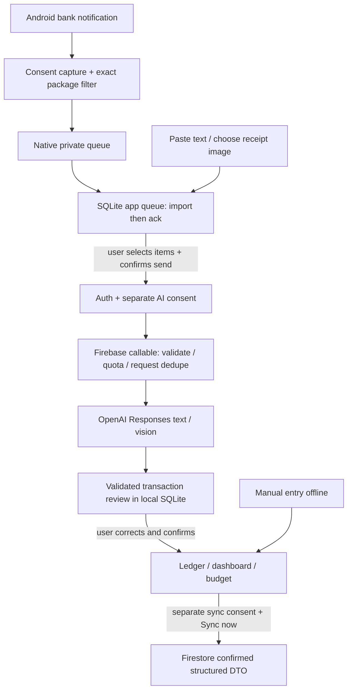

# Kesefly — Plan 4 người, OpenAI API + Firebase

## 1. Quyết định đã chốt

**Phát triển tiếp code hiện có, không scaffold lại.** Người dùng đã chọn bỏ inference on-device và chuyển sang OpenAI API. Không tải model, không GPU/NPU, không fallback local. API ChatGPT/OpenAI không đồng nghĩa tài khoản ChatGPT Plus/credit coding agent đã có quyền hoặc ngân sách API.

- Expo SDK58 / React Native0.88 / TypeScript / Expo Router, giữ phiên bản trong `package.json` và npm lockfile.
- SQLite là ledger và queue; AsyncStorage chỉ phục vụ Firebase Auth persistence, không thay ledger bằng snapshot mới.
- Giữ UI/theme/forms hiện có; không thêm Paper/Zustand hoặc đổi framework để giống plan cũ.
- Backend: Firebase Auth + Firestore + Cloud Functions callable `parseTransaction` + OpenAI Responses API.
- Model server mặc định: `gpt-6-luna`, đã đối chiếu [model docs](https://developers.openai.com/api/docs/models/gpt-6-luna): text/image, Structured Outputs, reasoning none. Quyền truy cập/billing của project phải smoke bằng account thật; không tự đổi model khi lỗi.
- Nhập tay, xem/sửa/xóa, dashboard và ngân sách vẫn offline. AI cần mạng, đăng nhập và consent riêng; không có offline AI giả.
- Deadline17:00; mục tiêu nghiệm thu16:30. Không lấy các mốc12:00 đã trôi qua để đánh dấu hoàn thành.

### 1.1. Luồng sản phẩm



**Thay đổi riêng tư quan trọng:** input văn bản/ảnh được người dùng chọn gửi sẽ đi qua Firebase tới OpenAI. Không được mô tả “mọi raw luôn ở trên thiết bị”. Không lưu raw trong Firestore/Storage/log app; điều đó không có nghĩa provider không có retention. `store:false` không phải zero-retention guarantee. Request đang gửi không thể được thu hồi khỏi bên nhận chỉ bằng tắt consent.

### 1.2. Baseline và phần cần chứng minh

| Phần | Code/contract | Cần nghiệm thu |
| --- | --- | --- |
| Local ledger | SQLite CRUD/tombstone, review, budget, UI | Restart/offline, không tính review vào totals |
| Android capture | Expo Kotlin module + private native queue | APK và notification ngân hàng trên thiết bị thật |
| AI | Callable OpenAI, consent-gated client, selected queue send | Deploy+secret+API project thật, text/ảnh và usage |
| Sync | Persistent Auth, strict DTO/rules, manual consent sync | Hai client cùng account, cross-UID deny, revision conflict |
| Web | SPA output single, SQLite WASM, Firebase Hosting config | Production export, COOP/COEP, refresh route transaction |
| Account data | Một DB thiết bị gắn UID cloud đầu tiên | Sticky-owner warning, không claim per-account isolated ledger |

Code có implementation không đồng nghĩa live deployment/inference đã pass. Bằng chứng kiểm tra nằm ở `docs/VERIFICATION.md`; lần setup local trước không thay thế nghiệm thu AI cloud mới.

## 2. Chia đúng 4 vai trò — một file một owner

Điền tên người thật trước khi tạo branch. Người4 là **integration owner**; owner module vẫn tự sửa lỗi kỹ thuật của mình.

| Vai trò | Vùng được sửa | Đầu ra |
| --- | --- | --- |
| **1 — Native Android & APK** | `modules/bank-notifications/`, `plugins/`, `src/core/ingestion/nativeCapture.ts`, `src/core/ingestion/nativeCapture.web.ts`, `app.json`, `eas.json` | Listener/capture, permission và APK |
| **2 — OpenAI backend & parser** | `functions/`, `src/core/ai/` **trừ client.ts và imagePayload files**, fixtures/parser tests riêng | Responses/schema/prompt/quota/idempotency, text+vision |
| **3 — Data/Auth/Sync & cloud client** | `src/core/database/`, `src/core/firebase/`, `src/core/ai/client.ts`, `src/core/ai/imagePayload.ts`, `src/core/ai/imagePayload.web.ts`, `src/types/`, `src/features/FinanceProvider.tsx`, `firebase.json`, `firestore.rules`, `firestore.indexes.json`, `storage.rules`, `.env.example`; data/rules tests riêng | Auth/consent/session fencing/persistence/sync/deploy |
| **4 — UI/Product & integration** | `src/app/`, `src/features/` **trừ FinanceProvider**, `src/shared/`, ingestion **trừ nativeCapture adapters**, root package/lock/tsconfig/Metro/ESLint/CI, `tests/finance.test.ts`, `README.md`, `PLAN.md`, `docs/` | UX, selected queue→review orchestration, web export, merge/acceptance |

- SettingsScreen chỉ người4 sửa; người1/2/3 cung cấp hàm/trạng thái/copy yêu cầu, không cùng sửa file Settings.
- FinanceProvider chỉ người3 sửa; người4 gọi `useFinance`, không tự ghi SQL/AsyncStorage hoặc tạo state store thứ hai.
- Root dependency và lockfile chỉ người4 sửa qua `npx expo install`; Functions dependencies/lockfile chỉ người2 sửa. Cả đội nhận cùng baseline lockfile.
- `app.json` người1 giữ, `firebase.json` người3 giữ. Web output/hosting thay đổi cần yêu cầu đúng owner; người4 không giành file để sửa tạm.
- Mỗi owner được thêm test riêng `tests/<area>.test.ts`; shared `tests/finance.test.ts` do người4 tích hợp. Không tạo folder/file rỗng dự phòng.

## 3. Contract thật của repo

### 3.1. Domain — nguồn chuẩn `src/types/transaction.ts`

| Field/khái niệm | Quy tắc |
| --- | --- |
| ParsedTransaction | amount,currency,type,merchant,category,date,confidence |
| amount | VND nguyên dương safe integer, tối đa1e15; không float/currency conversion ngầm |
| type | INCOME hoặc EXPENSE, amount luôn dương |
| category | Food & Drink,Shopping,Transport,Bills,Transfer,Salary,Other; nhãn Việt trong UI |
| merchant/date | Merchant trim1..160 không control char; date calendar-valid normalized UTC ISO |
| Transaction | ParsedTransaction + id,source,sourcePackage,status,updatedAt,deletedAt,syncedAt |
| status | review hoặc confirmed; mọi output AI là review |
| timestamps | updatedAt/deletedAt/syncedAt là epoch milliseconds hoặc null theo type; không đổi thành ISO revision |
| source | notification/manual/image; manual gồm cả nhập tay và text dán |
| QueuedAlert | id,text,imageUri,source,sourcePackage,receivedAt,error; raw local trước khi gửi |

Không áp schema `categoryId/occurredAt/createdAt/note/TransactionDraft` của plan cũ. Validator `src/core/ai/validation.ts` dùng chung server/client, không viết hai validator lệch nhau. Không đủ facts thì transaction null/lỗi và nhập tay; không bịa amount/merchant. ReceivedAt là reference nếu ngày thiếu theo prompt; người dùng vẫn kiểm tra. Confidence model tự chấm không phải xác suất chính xác.

### 3.2. Cloud AI — nguồn chuẩn `src/types/ai.ts`

Request: `requestId`, `consentVersion: openai-input-v1`, `text`, `receivedAt`, `image` hoặc null. Image chỉ là base64+mime JPEG/PNG/WebP, không external URL. Response: `{ transaction: ParsedTransaction | null }`. Tên callable `parseTransaction`, region mặc định `asia-southeast1`.

- Firebase UID từ verified Auth context, không client-supplied UID. Model/prompt server-controlled, không arbitrary tools/URL/proxy.
- Text tối đa6000ký tự, một ảnh tối đa2MiB decoded; app normalize JPEG1024px trước persist/send. Client và server kiểm tra bounds; server kiểm tra MIME/magic bytes.
- OpenAI key chỉ Secret Manager. Responses strict `text.format` schema root object, `store:false`, `reasoning.effort:none`, max_output_tokens512, timeout25s, SDK retries0. Refusal/incomplete/invalid JSON phải thành lỗi an toàn, không eval/repair arbitrary output.
- Request ID gắn queue ID, digest ràng UID+payload. Retry cùng ID không gọi provider lần nữa nếu đã pending/terminal. ID reuse payload khác bị từ chối. Không tự generate ID mới để né quota; muốn input mới tạo queue item mới sau hành động rõ của người dùng.
- Server private request tombstones ngăn replay, cache chỉ output có cấu trúc tối đa7ngày theo logical expiry; TTL deletion được cấu hình riêng, không xóa tombstone rồi cho provider chạy lại.
- Transactional quota trước provider:100requests/UID/ngày,1000project/ngày, reservation0.02USD/attempt với project cap5USD tích lũy. Đây là giới hạn conservative reservations/call attempts, **không phải cam kết invoice mọi dịch vụ không vượt5USD**. Functions/Firestore/network tính riêng; không tự reset cap trong demo.
- Không raw notification/ảnh/prompt/provider error trong database/log. Cache structured fields vẫn là dữ liệu tài chính nhạy cảm, không gọi là anonymous.

### 3.3. Client consent và selected queue

`src/core/ai/client.ts`: `isAIConfigured`, `getAIConsent`, `setAIConsent`, `parseCloudAlert`, `assertAISession`. Consent version lưu theo UID, khác cloudSync. Auth/account/generation/revoke được kiểm tra trước request, sau response và trước local save; output stale không được gán sang account mới.

`processQueue(ids)` chỉ nhận snapshot ID do người dùng chọn+xác nhận. Không auto-send khi foreground, mới paste, import notification, login hoặc bật consent. Những hành động này chỉ enqueue/import/refresh local. UI hiển thị số mục, text/ảnh và nơi nhận trước gửi; cancel không gọi API. Mất mạng giữ input cho người dùng, không local inference fallback.

Parse thành công → transaction review giữ queue ID → xóa raw local/ảnh. Null/error không tạo transaction sai; input giữ đến discard/TTL7ngày. Exact IDs chống replay; amount+direction±5phút chỉ gợi ý nghi trùng, không tự gộp/xóa.

### 3.4. Native seam

`nativeCapture.ts`: isCaptureAvailable,getCaptureStatus(enabled,consent,packages,pending),configureCapture,openCaptureSettings,openBatterySettings,readNativeAlerts,acknowledgeNativeAlerts,protectPrivateStorage.

Capture chỉ sau consent và exact bank package allowlist; ghi SQLite native trước JS, JS persist rồi mới ack. Capture không yêu cầu login và **không tự gửi OpenAI**. Permission enabled không hứa connected liên tục/OEM không kill. Revoke clears native+imported notification queue; raw không được backup. iOS/web không thể đọc notification ứng dụng khác; nhập tay/text/ảnh vẫn là đường dùng được.

### 3.5. Ledger/sync/account

- Giữ SQLite serial write repository và FinanceProvider. Dirty marker là syncedAt null; tombstone deletedAt, conditional markSynced theo revision.
- Firestore DTO chọn field rõ; không sync sourcePackage,syncedAt,raw,ảnh hoặc lỗi. Chỉ confirmed và tombstones. Budget là một local monthlyBudget limit áp dụng mọi tháng, chưa per-month/sync.
- Đồng bộ chỉ sau Auth+consent sync+bấm Sync; không biến thành auto-sync. LWW updatedAt client, equal server wins trừ tombstone thắng live. Không đổi thành setDoc last-arrival-wins hoặc thêm serverUpdatedAt ngoài rules.
- Một DB thiết bị gắn UID cloud đầu tiên. Logout tắt AI/sync consent, bỏ hiệu lực output đang chờ nhưng giữ ledger local và capture config; login account khác không tự có ledger riêng và bị chặn cloud ownership. UI phải nói rõ, không gọi đây là per-account isolation. Muốn đổi owner dùng explicit reset/export/migration riêng, không xóa pending để chữa tạm.

## 4. Nhiệm vụ cụ thể từng người

### Người1 — Native/Android

1. Build/cài APK từ code mới không có runtime AI native; giữ module notification và backup protection. Không giữ yêu cầu ARM64/GPU vì AI cloud không cần.
2. Chọn bank package đã xác minh trên máy; debug notification producer phải ghi rõ không phải ngân hàng thật.
3. Test allowlist/consent/OTP/group summary,persistence khi JS chết,read không destructive,ack sau import,revoke permission. Không hứa bắt được event OS chưa giao/force-stop.
4. Phối hợp người4 prefilter: không loại giao dịch thật chỉ vì memo có “cashback/ưu đãi”; OTP vẫn không gửi AI.
5. Build development và preview từ commit merge, bàn giao APK/device/OS/package/permission steps, không dùng prebuild làm chứng cứ APK.

### Người2 — OpenAI/backend

1. Verify OpenAI project access và model ID bằng secret server; giữ key khỏi frontend/PR/log. Deploy support qua người3.
2. Hoàn thiện prompt/schema/text+vision,runtime validation và errors/refusal; một input tối đa một transaction, không số dư nhầm amount.
3. Kiểm tra transactional quotas,idempotency,pending/failed/cache expiry và request mismatch. Reservation không được release khi provider usage/timeout chưa rõ mà dẫn đến undercount.
4.20fixtures tổng hợp: thu4,chi4,separators/balance4,ambiguous4,OTP/promo4; test riêng image khi có ảnh tổng hợp. Đo API latency/usage thật, không giả response.
5. Handoff callable/types/config/errors/quota docs cho người3/4; không sửa UI/provider/root lockfile.

### Người3 — Data/Auth/Sync/deploy

1. Setup Firebase project/Auth/Blaze/Functions IAM/secret; persistent Auth dùng existing named Firebase app. Giữ SQLite, không thay storage architecture.
2. Client versioned perUID AI consent tách sync, auth-generation fence,in-flight revoke/logout,sticky owner. SDK error sanitize không echo financial input/key.
3. Test data restart,conditional ack/revision,create/edit/delete sync giữa hai client; rules deny crossUID/raw fields/private AI metadata. Test Auth chuyển trong request không save stale.
4. Cung cấp provider state/actions cho người4. Root Firestore public DTO không mở thêm raw collections; Admin-only request/quota collections default deny.
5. Deploy rules/functions/hosting, đặt đúng region/env cho APK/web; tạo domain authorized và TTL cache policy theo backend. Live inference chưa pass thì ghi rõ.

### Người4 — Product/UI/integration

1. Giữ routes/theme/forms. UI phân biệt nhập tay offline và AI cloud online; consent/disclosure+selected queue confirmation+safe errors,review checkbox trước totals,delete confirmation.
2. Single Settings owner, dùng interface thật. Không nhãn “AI local/private” khi raw qua cloud; capture consent,AI consent,sync consent là ba quyết định khác nhau.
3. Điều phối queue persistence/normalization and pipeline; không auto-submit. Chặn stale output/discard races cùng người3, không tạo duplicate transaction khi retry.
4. Đầu việc UI còn cần: ngày/tháng nhất quán Asia/Ho_Chi_Minh (helpers hiện dùng device timezone), test ranh giới tháng khi device timezone khác; filter tháng/thu-chi nếu cần, pending sync status từ người3. Không mô tả việc còn thiếu là đã xong.
5. Root dependencies một đầu mối,merge/checks/export web sớm,COOP/COEP/WASM/deep-link reload phối hợp người1/3. Bàn giao demo và báo cáo pass/chưa test/fail.

## 5. Quy trình làm riêng rồi ghép

1. Người4 tạo baseline commit chứa code/config/lockfiles mới, không secrets/raw/generated native dirs. Cả bốn branch từ cùng commit; không chạy create-expo-app/reset.
2. Bốn clone/worktree/branch riêng: feat/native-capture,feat/openai-parser,feat/data-sync,feat/product-ui. Không để bốn agent ghi chung working tree rồi commit toàn bộ.
3. File ownership mục2 là nguồn chuẩn. Contract delta báo trước với người3+caller owner; root package chỉ người4. Không viết interface/provider/validator thứ hai cho qua compile.
4. Merge PR nhỏ giữ contract trước. Delta thật: shared types/provider do người3 và validator/backend người2 được đồng bộ trước caller UI; integration owner điều phối, không bỏ implementation placeholder vào main.
5. Sau dependency change,rebase main và npm ci; Functions npm ci riêng. Mỗi PR ghi baseline,paths,contract delta,cách test,observed result,config/blocker.
6. Sau lát thay đổi hoàn chỉnh,owner chạy test hẹp,lint/typecheck; người4 chạy npm run check + functions build/tests trên commit merge. Native thay đổi cần APK mới, không web/JS hot reload thay chứng cứ.
7. Owner tự sửa lỗi trong vùng mình; người4 không copy folder từ branch cũ ghi đè branch khác. Artifact ghi commit + environment để APK/web/backend không lệch nhau.

## 6. Keys, tài khoản và setup

| Cấu hình | Cần cho | Nguồn / nơi lưu |
| --- | --- | --- |
| EXPO_PUBLIC_FIREBASE_API_KEY | Auth/AI/sync | Firebase Project settings → Web app SDK config apiKey; `.env`/EAS public env |
| EXPO_PUBLIC_FIREBASE_AUTH_DOMAIN | Auth | authDomain cùng config |
| EXPO_PUBLIC_FIREBASE_PROJECT_ID | Auth/Functions/Firestore | projectId, không nhầm projectNumber |
| EXPO_PUBLIC_FIREBASE_APP_ID | Firebase app | appId, không phải Android package |
| EXPO_PUBLIC_FIREBASE_FUNCTIONS_REGION | Callable | asia-southeast1 mặc định, phải khớp deploy |
| EXPO_PUBLIC_FIREBASE_MESSAGING_SENDER_ID | Tùy chọn | Không phải key capture notification, chưa cần FCM |
| **OPENAI_API_KEY** | AI server | OpenAI API project riêng → Firebase Secret Manager; không EXPO_PUBLIC |
| Expo project access/signing | APK/EAS | Một project chung, invite đội; EAS managed credentials, không Git |
| Firebase IAM + Blaze | Functions deploy/runtime | Project owner cấp quyền cần thiết; billing budget alerts không thay app quota |
| GitHub collaborator access | PR/merge | Mỗi người account riêng; không share token trong repo |

Không cần model download URL/hash,Hugging Face token,Nitro modules,FCM server key hoặc client Firebase Admin service account. OpenAI API billing/quota riêng với ChatGPT subscription; không giả định credit400USD có thật.

### 6.1. Lệnh setup

```bash
npm ci
npm ci --prefix functions
npm run functions:build
```

Copy `.env.example` thành `.env`, điền public Firebase config. Bật Firebase Email/Password,create Firestore production mode,Authorized domains cho localhost/domain demo. Không mở rules allow-all.

```bash
npx firebase-tools login
npx firebase-tools functions:secrets:set OPENAI_API_KEY --project YOUR_PROJECT_ID
npx firebase-tools deploy --project YOUR_PROJECT_ID --only firestore,functions
```

Secret nhập qua CLI prompt, không đưa giá trị lên command line/chat. Đọc `functions/.env.example` cho server params hiện hành; app không chọn model tùy ý. Configure TTL cache theo backend docs nếu cần physical cleanup; logical expiry vẫn phải có hiệu lực không phụ thuộc TTL timing.

```bash
npm run web
# public website
npm run web:export
npx firebase-tools deploy --project YOUR_PROJECT_ID --only hosting
# APK
npx eas-cli login
npx eas-cli init
npm run build:android:dev
```

App output single + hosting SPA rewrite; cần COOP/COEP cho SQLite WASM. Sau deploy test direct `/transaction/<id>` reload,không chỉ home page. EAS development/preview và web export cần cùng Firebase project/region; restart Metro hoặc rebuild/re-export sau đổi EXPO_PUBLIC.

Local emulator chỉ bật EXPO_PUBLIC_USE_FIREBASE_EMULATORS=true với demo Firebase config,loopback hosts theo template; Android dùng adb reverse cho9099/8080/5001. Backend `.secret.local` chỉ local,ignore; không dùng production key để tests tự động hoặc provider response giả làm smoke live.

## 7. Checkpoints và nghiệm thu

| Mốc | Yêu cầu |
| --- | --- |
| Ngay nhận baseline | Phân tên4owner,branch/lockfile chung; Firebase/API billing/access kiểm tra; bắt đầu APK/export sớm |
| Checkpoint đầu sau30phút hoặc sớm hơn | Callable deploy/config status thật,APK status,web export blockers và contract delta đã lộ |
| Tích hợp sớm | Notification/text/ảnh→queue→explicit send→OpenAI→review→confirm→totals; adapters thật |
|16:00freeze | Chỉ sửa lỗi,không đổi stack/data model/quota mechanism |
|16:30nghiệm thu | APK+URL+backend cùng commit/env,tests+demo evidence,ghi chưa đạt trung thực |
|16:30–17:00 | Gửi bài/video/artifacts đúng yêu cầu cuộc thi |

Nếu đã qua mốc,báo blocker không tự lùi deadline hay giảm “OpenAI thật” thành mock/regex. Nhập tay hoạt động không chứng minh AI chạy.

### Ca bắt buộc

| ID | Bằng chứng | Owner |
| --- | --- | --- |
| N1 | Bank allowlist capture sau consent; OTP/disallowed không queue |1+4|
| N2 | JS chết/restart,persist-before-ack,replay một review,revoke dọn raw |1+3+4|
| A1 | Không login/AI consent/cancel chọn gửi → không OpenAI call |2+3+4|
| A2 | Selected snapshot only; newly arrived items không bị gửi ké |3+4|
| A3 | Responses thật text+image→strict validation→review;refusal/timeout/null không giao dịch sai |2|
| A4 | Request lặp/pending/payload mismatch/quota cap không tăng provider calls |2|
| A5 | Offline giữ queue; revoke/logout/account switch không save stale response |3+4|
| D1 | CRUD/budget/review qua restart;review ngoài totals;dedupe không xóa hai khoản thật |3+4|
| D2 | Sync same account hai client,edit-in-flight,tombstone,crossUID rules deny |3|
| U1 | Consent tách3loại,keyboard,mobile/web,Vietnam timezone/filter |4|
| W1 | Export/deploy/deep-link reload,SQLite WASM headers,Auth trên domain |3+4|
| R1 | Lint/typecheck/tests/backend build;APK cài được từ commit ghi nhận |4+1|

Mỗi ca có pass/chưa test/fail+nguyên nhân. Không tick live provider/deploy/device nếu chưa quan sát. Cache structured output là sensitive nên dùng fixtures tổng hợp,không dán SMS thật/keys vào PR. Artifact:APK+commit/device,URL+commit/env,backend region/deploy,fixtures/latency/usage và giới hạn.

## 8. Prompt giao việc nhanh

**Người1:** Đọc PLAN mục1–6. Sở hữu native/app.json/eas theo bảng; build APK code mới,capture consent/allowlist/persistence/revoke thật. AI là OpenAI cloud,không runtime model/ABI restrictions. Handoff device/package/APK và N1/N2/R1. Settings chỉ gửi yêu cầu cho người4.

**Người2:** Đọc PLAN mục1–6. Sở hữu Functions/parser/schema/quota/fixtures,không client auth/UI. Dùng Responses gpt-6-luna server secret,strict schema,bounds,text+vision,idempotency+reservation trước provider,no raw logs. Handoff A1/A3/A4,usage+errors,không mock live output.

**Người3:** Đọc PLAN mục1–6. Sở hữu SQLite/Auth/sync/cloud client/provider/contracts/env/Firebase deploy. Giữ sticky owner và data contract;AI consent perUID tách sync,session fencing/save guard. Test offline/revision/tombstone/crossUID/account-switch. Không đổi ledger sang AsyncStorage,không key frontend. Phối hợp người2 deploy và người4 hosting.

**Người4:** Đọc PLAN mục1–6. UI+integration owner,giữ theme/forms/routes,selected queue confirmation/privacy copy thật. Root dependencies một đầu mối,FinanceProvider người3,app.json người1,firebase.json người3. Export/merge/acceptance sớm,không scaffold MD3 mới. Ghi pass/chưa test/fail và commit/env artifacts.

## 9. Tài liệu tra cứu

`README.md` cho setup; `docs/ARCHITECTURE.md` cho data/privacy; `docs/VERIFICATION.md` cho evidence. `PLAN.md` là nguồn phân công4người duy nhất,`docs/TEAM.md` dẫn về đây.

- [Expo SDK58](https://docs.expo.dev/versions/v58.0.0/),[Expo web export](https://docs.expo.dev/guides/publishing-websites/).
- [Firebase callable](https://firebase.google.com/docs/functions/callable),[Secrets](https://firebase.google.com/docs/functions/config-env).
- [OpenAI Structured Outputs](https://developers.openai.com/api/docs/guides/structured-outputs),[Vision](https://developers.openai.com/api/docs/guides/images-vision),[model](https://developers.openai.com/api/docs/models/gpt-6-luna).
