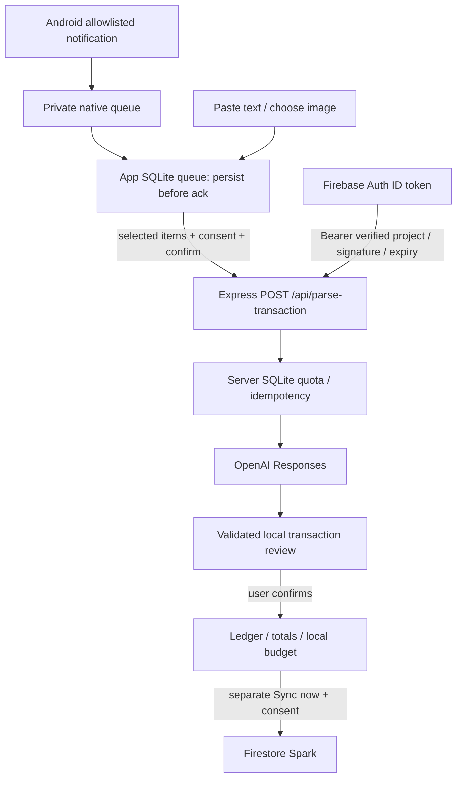

# Kesefly — Plan 4 người: Express + OpenAI, Firebase Spark

## 1. Quyết định và chi phí

**AI backend là Node.js22/Express5 chạy độc lập trong `server/`. Không dùng Firebase Cloud Functions, Cloud Run, Secret Manager hoặc yêu cầu nâng Blaze.** Firebase Spark chỉ dùng Email/Password Auth, Firestore ledger sync và tùy chọn static Hosting trong quota miễn phí.

Người dùng không muốn bước billing/800.000VND đang gặp. Không thực hiện nâng gói hay đăng ký host trả phí. Bảng giá Firebase phân biệt Spark no-payment-method và Blaze pay-as-you-go; không suy mọi tài khoản có cùng khoản phí cố định. Kiến trúc này bỏ hẳn dịch vụ đòi Blaze thay vì tìm cách né billing.

**OpenAI API vẫn có phí riêng.** ChatGPT Plus/credit coding agent không tự cấp APIcredit. Express local dùng máy đội không cần thuê host,nhưng máy phải mở và mạng phải truy cập được; public hosting/free-tier có giới hạn,không hứa uptime/chi phí0 vĩnh viễn.

Giữ ExpoSDK58/RN0.88/Router/SQLite/UI hiện có. Không scaffold lại,không đổi AsyncStorageledger/Paper/Zustand. ManualCRUD/dashboard/budget offline; AI online sauAuth+AIconsent+selectedsend; syncconfirmedfields là quyền riêng.

## 2. Luồng và contract



- `src/types/transaction.ts` nguồn chuẩn:ParsedTransaction amount,currency,type,merchant,category,date,confidence. VND nguyên1..1e15,typeINCOME/EXPENSE,merchanttrim1..160,category enum sẵn,datecalendarUTCISO.
- Transaction thêm id,source,sourcePackage,status,updatedAt,deletedAt,syncedAt; revision epochmilliseconds,review không tính totals; tombstone không hard-delete sync.
- `src/types/ai.ts`: requestId,consentVersion=`express-openai-input-v1`,text,receivedAt,image hoặcnull. Text<=6000,mộtảnh JPEG/PNG/WebP decoded<=2MiB. AppnormalizeJPEG1024px.
- `POST /api/parse-transaction`: **JSON request trực tiếp**,không callable envelope; header `Authorization: Bearer <Firebase ID token>`. Success `{transaction:ParsedTransaction|null}`. Error `{error:{code,message}}` với fixedsafeerror,không raw/providerbody.
- `GET /health` xác minh process đang chạy,không providercall và không chứng minh OpenAIkey/modelaccess.
- Serververify FirebaseRS256 bằng publicGooglekeys,issuer/audience/project/sub/expiry/time; không tin UIDclient. Không cần serviceaccount để verify publicJWT. Tokenrevocation/accountdisable không được kiểm tra qua publicsignature,phải ghi giới hạn.
- Firebase Auth vẫn cloud miễn phí theoquota; rawAI đi **app→Express của đội→OpenAI**,không qua FirebaseFunctions. `store:false` khôngzero-retentionguarantee; không retractrequest đã gửi.
- Capture/paste/foreground/login/bậtAIconsent chỉ lưu/importlocal,không auto-send. User chọn snapshotIDs rồi xác nhận. Newqueueitems không gửi ké. Tắtconsent/logout/sessionchange ngăn outputstale lưu vàoledger.

## 3. Ownership 4 người

| Người | Vùng file duy nhất | Nhiệm vụ |
| --- | --- | --- |
| **1 — Native/APK** | modules/bank-notifications,plugins,nativeCapture adapters,app.json,eas.json | Capture/permission/backup,APK,HTTPLANdev config |
| **2 — Express/OpenAI (bạn)** | server/**,core/ai/validation.ts | ExpressHTTP/authverify/CORS,prompt/schema,text+vision,SQLitequotas,fixtures/live smoke |
| **3 — Data/Auth/Sync** | core/database,core/firebase,core/ai/client.ts,endpoint.ts,imagePayload files,types,FinanceProvider,firebase.json,Firestore rules/indexes,envtemplate | FirebaseSpark/Auth/clientBearer/consent/sessionguard/ledger/sync,publicconfig |
| **4 — UI/Integration** | routes,features trừFinanceProvider,shared,ingestion trừnativeCapture,rootpackage/lock/CI/config,tests/finance,README/PLAN/docs | UIselectedsend/review,mergechecks,webexport,docs/demo |

Settings chỉ người4; FinanceProvider chỉ người3; rootdependencies chỉ người4; serverpackage/lock chỉ người2. Người1 giữ app.json,người3 giữ firebase.json. Không tạo contract/store/validator thứhai để chữa lệchinterface.

**Không ai cần setup Functions/Blaze.** Người3 setup FirebaseSpark Email/Password và Firestore,rules; người2 chạy Express local + giữOpenAIkey; người4 gánEXPO_PUBLIC_AI_API_URL vàtestUI; người1 trỏ APK đúnghost/ADBport.

## 4. Backend vận hành không phụ thuộc trả phí host

Node>=22.19 dùng `node:sqlite` có sẵn,không cần database/cloudquota ngoài. Serverkey trong ignored `server/.env` hoặc hostenvironment,khôngEXPO_PUBLIC/Firestore/source. Server default127.0.0.1:3001; LANchủđộngHOST0.0.0.0. Publicserver phải HTTPS; trustedLANHTTP chỉ demo explicitoptin,có rủi ro raw/token plaintext.

Reservations/cache/budget trong durableSQLite `DB_PATH`,preparedqueries+atomictransactions.100/user/dayUTC,1000global/dayUTC,2centsreservation/attempt,lifetime500cents. Caplàreservation khôngcamkếtactualinvoice. Permanentrequesthash/digest/status chống replay; resultcache7ngày logicalexpiry,purgeexpiredcacheonaccess. Không rawtext/images/key/UID trongstore/log.

Pending2phút/failed/expired không auto retryprovider vì có thểđãbilled; sameUID+ID+payload cachehit khôngthêmcall,differentpayloadconflict. DBfile phải persist sau restart. **Một serverinstance dùng một durableDB chung**; không scale nhiềuhost vớiDBriêng hoặc ephemeralfreehost vì sẽ resetbudget/dedupe. BackupprivateDBan toàn,không xóađểretry.

Expressserver có thể serve `dist/` SPA sau `npm run web:export`,cùngoriginapi nên không cầnstatic hostcho localdemo. Nếu website ởFirebaseHostingSpark/hostkhác,Express phải publicHTTPS và CORS_ORIGINS allowexactdomain. StaticHosting không chạyNodeAPI và không proxyFunctions.

## 5. Setup nhanh

```bash
npm ci
npm ci --prefix server
```

Copy root`.env.example`→`.env` với FirebaseWebpublicconfig + `EXPO_PUBLIC_AI_API_URL=http://localhost:3001`. Copy`server/.env.example`→`server/.env`,điền `FIREBASE_PROJECT_ID` trùngprojectclient và `OPENAI_API_KEY` khi có. Không cầnFirebaseAdminJSON/SecretManager. Không cókey thìserverhealth/authvalidation vẫnchạy,AItrả unavailablekhônggiảresponse.

```bash
# Terminal1 API
npm run server:dev
# Terminal2 mobile/web UI
npm run web
```

FirebaseConsole:Spark,Email/Passwordenable,defaultFirestoreproductionmode,authorizeddomains,rulesdeploy:

```bash
npx firebase-tools login
npx firebase-tools deploy --project PROJECT_ID --only firestore
```

StaticHosting tùy chọntrongSparkquota:

```bash
npm run web:export
npx firebase-tools deploy --project PROJECT_ID --only hosting
```

### LAN/Android

- AndroidUSB:`adb reverse tcp:3001 tcp:3001`; clientlocalhost3001 đi tới máydev,không phải publichost. Nếu chạy Authemulator cũngreverse9099,Firestore8080.
- Wi-FiLAN:serverHOST0.0.0.0,clienturlhttp://192.168.x.x:3001 vàEXPO_PUBLIC_ALLOW_INSECURE_AI_HTTP=true,alloworigin web nếu cần; firewallport3001 vàsameWiFi. HTTPdemo khôngdùngdữliệuthật.
- APKAndroid chặn cleartextHTTP nếu chưa opt-in nativebuild; configplugin chỉ chophép khi đúnglocaldevflagvàprivate/loopbackurl. Đổi flag cầnrebuildAPK. Publicdemo nênHTTPS,nativeflagfalse.
- WebsiteHTTPS không gọiHTTP localhost/LAN do mixedcontent; serveUI cùngExpressHTTP trênmáydemo hoặc dùngpublicHTTPS API. Không gửikeytrực tiếpbrowser đểnéhosting.

### Envs

| Nơi | Biến | Nội dung |
| --- | --- | --- |
| root.env | EXPO_PUBLIC_FIREBASE_API_KEY/AUTH_DOMAIN/PROJECT_ID/APP_ID | FirebaseWebconfigpublic |
| root.env | EXPO_PUBLIC_AI_API_URL | OriginExpress,khôngkey,khôngFunctionsregion |
| root.env | EXPO_PUBLIC_ALLOW_INSECURE_AI_HTTP | falsemặcđịnh,truechỉtrustedprivateLANdemo |
| server.env | OPENAI_API_KEY | SecretOpenAIAPI,billingriêngChatGPTsubscription |
| server.env | FIREBASE_PROJECT_ID | Issuer/audienceverify,khớpAuthclient |
| server.env | HOST/PORT/DB_PATH/CORS_ORIGINS | Bind/persistentDB/exactallowedweborigins |

Authemulator chỉ explicitflag +demo-project +nonproduction; không cho unsignedtokenproduction. Server.env.example là nguồn envnameschi tiết. FirebaseSparkquota vượt giới hạn vẫn có thể ngừngdịchvụ; khônghứa unlimitedfree.

## 6. Role2 công việc và bàn giao

Bạn giữ toàn bộserver:Express route/auth/bodylimit/CORS,safeerrors,OpenAIResponsesgpt-6-luna strictschema,highdetailreceipt,timeout25s,maxoutput512,retries0,usageevents khôngraw.20text+1PNGfixtures tổnghợp giữexpectedsemantics và liveHTTPsmoker cóexplicit--live+stable--run-id. TestunitkhônggọilàLLMaccuracy.

Người3 hỗ trợFirebaseproject/AuthvàclientBearer,khôngcầnbilling. Người4 ghépUIconsent hướngExpress,khôngđổi response. Sharedtypes/validator thayphảibáocallerowners trướcmerge.

Khi cókey:putserver.env,restartExpress,đăngnhậpapp,bậtconsentmới,chọnfixture/queueitem,xácnhậngửi. Live smoke chạy quaExpressBearer/quota,khôngcallOpenAItrựctiếp. Secretrotationrestartserver,khôngFunctionsdeploy.

## 7. Branch và tích hợp

Mộtbaselinecommit mới,cùngroot/serverlockfiles.4clone/worktree/branchriêng,nativetask/server-parser/data-sync/product-ui. Khôngbốnagentchungworkingtree. PRnhỏ đúngowner,khôngformatrepo hoặcgeneratedandroid/ios,secret,DBfile.

Contractdeltakhóaphảiđồngbộ người2server +người3client+người4UI. Rootdependencyngười4,serverdependencyngười2. Mergekhôngcopyfoldercũghiđèmới. Người4integrationowner nhưngmoduleowner tựfixfailure.

```bash
npm run check
npm run server:build
npm run typecheck --prefix server
npm run server:test
```

Sau nativechangebuildAPK lại;hotreload/webkhôngchứngminh APK. Deadline17:00,freeze16:00/nghiệmthu16:30nếucònkịp;quámốcthìbáochưađạt,khônggiảpass.

## 8. Nghiệm thu

| Ca | Owner |
| --- | --- |
| HTTPhealth,missing/invalidBearer401,wrongproject/expiredtoken,CORSdenied,bodybounds,safeerror |2+3|
| SQLite quotaatomic,concurrentsameID1attempt,restartpersists,expiredcachetombstone,budgetcap |2|
| Text/ảnhlive→review,OTP/promo/amountvsbalance/schema/date,falseinput→null/error |2|
| Noauto-send,selectedsnapshot,cancel/revoke/logoutstaleoutput,consent3loại |3+4|
| Nativepersist-before-ack,restart,exactbankpackage/revoke |1+3|
| OfflineledgerCRUD/budget,confirmedonly,peerFirestoremanualsync,tombstones |3+4|
| Webexport/ExpressSPA/deeplinkreload/COOPCOEP,APILAN/HTTPS reachablefromdemodevice |1+2+4|

Evidencepass/chưatest/fail rõ. KhôngkeythìkhôngclaimliveAPI/usage/accuracy. Authunit/signaturetests khôngthayprojectconfiglive. BáocáoartifactAPK+commit,APIorigin/DBpersistence,UIorigin+env,parserfixtures/usagevàcácgiớihạn.

## 9. Prompt giao việc

**Người1:** Giữnativecapture/backup,buildAPK vàtrỏExpressreachable. KhôngFunctions/model. Testpermissions/lifecycle/ADB/LANHTTPdevflag. UISettings yêu cầungười4.

**Người2:** Sởhữu server/Express/OpenAI/JWTverify+SQLitequota/fixtures. KhôngBlaze/Adminsecret/Firestorequotas. Keyserver.env,singleinstancepersistentDB,safeerrors,noauto retryprovider. Bàn giaoHTTPcontract vàliveharness.

**Người3:** FirebaseSparkEmailAuth/Firestore/rules/manualsync,appBearer/consent/sessionguard/stickyowner. APIURLconfigkhôngFunctionsregion,không đưakeyfrontend. Testaccountisolation vàsync.

**Người4:** UI/selectedsend/review vàintegration,privacyrecipientExpress→OpenAI,rootpackages/CI/webexport/docs. Khôngscaffoldlại,khônglàmsharedSettings/providerđèowner. Ghiđúngruntimeevidence.

Nguồn: [Firebasepricing](https://firebase.google.com/pricing),[FirebaseIDtokenverification](https://firebase.google.com/docs/auth/admin/verify-id-tokens),[Express5](https://expressjs.com/en/5x/api.html),[Node22SQLite](https://nodejs.org/docs/latest-v22.x/api/sqlite.html). Setup`README.md`,API`server/README.md`,evidence`docs/VERIFICATION.md`.
