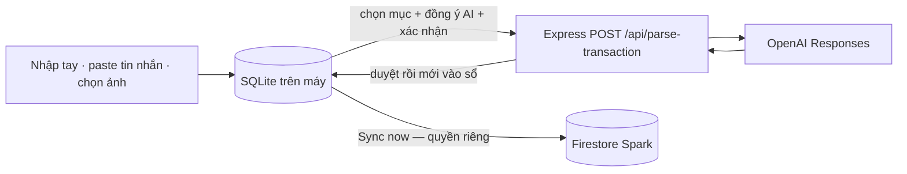

# Kesefly

Ứng dụng ghi chép chi tiêu cá nhân: Expo SDK 58 / React Native, dữ liệu nằm trong SQLite ngay trên máy. Phần AI — biến tin nhắn ngân hàng hoặc ảnh hoá đơn thành một giao dịch có cấu trúc — chạy qua một server Node/Express riêng trong `server/` rồi mới gọi OpenAI. Nhóm không dùng Cloud Functions, Cloud Run hay Secret Manager, cũng không cần nâng Firebase lên Blaze. Firebase Spark chỉ giữ hai việc: Auth Email/Password và Firestore để đồng bộ những giao dịch đã xác nhận, vẫn nằm trong hạn mức miễn phí.

Hai điểm hay bị hiểu sai:

- **OpenAI tính phí theo tài khoản API của bạn**, tách hẳn khỏi gói ChatGPT. Gói ChatGPT không tự kèm credit API.
- Server Express chạy trên máy của nhóm nên không tốn tiền thuê host, nhưng bù lại máy phải đang bật và điện thoại/browser phải truy cập được tới nó trong lúc demo.



## Chuẩn bị

Node 22.19.0 (xem `.nvmrc`), npm, và cả hai lockfile được cài:

```bash
npm ci
npm ci --prefix server
```

Rồi tạo hai file env:

- `.env.example` → `.env`: điền config web của Firebase và origin của API.
- `server/.env.example` → `server/.env`: điền `FIREBASE_PROJECT_ID` trùng với project Auth, và `OPENAI_API_KEY` khi đã có.

| File | Biến | Ý nghĩa | Lấy ở đâu |
| --- | --- | --- | --- |
| `.env` | `EXPO_PUBLIC_FIREBASE_API_KEY` | API key web của Firebase | Console → Project settings → Web SDK |
| `.env` | `EXPO_PUBLIC_FIREBASE_AUTH_DOMAIN` | `authDomain` cùng config | như trên |
| `.env` | `EXPO_PUBLIC_FIREBASE_PROJECT_ID` | `projectId` | như trên |
| `.env` | `EXPO_PUBLIC_FIREBASE_APP_ID` | `appId` | như trên |
| `.env` | `EXPO_PUBLIC_AI_API_URL` | Origin của Express, ví dụ `http://localhost:3001` | bạn tự đặt |
| `server/.env` | `FIREBASE_PROJECT_ID` | Project dùng để verify ID token | trùng project Auth |
| `server/.env` | `OPENAI_API_KEY` | Key OpenAI, chỉ nằm ở server | project API đã bật billing |

Mấy giá trị `EXPO_PUBLIC_*` là công khai, chúng đi thẳng vào bundle — thứ bảo vệ dữ liệu là Firestore rules và Auth, không phải việc giấu key. Ngược lại, **key OpenAI không bao giờ được đặt trong `.env` gốc, Firestore, `app.json` hay git**; chỉ `server/.env` hoặc biến môi trường của host. Server verify Firebase ID token bằng public JWT key của Google nên không cần service account JSON.

## Chạy lần đầu

Hai terminal:

```bash
npm run server:dev     # Express, mặc định 127.0.0.1:3001
npm run web            # giao diện Expo
```

Giao diện nhập tay dùng được ngay, chưa cần Firebase hay key nào. `GET http://localhost:3001/health` chỉ nói process còn sống — nó không gọi OpenAI và không chứng minh key hay model access đúng. Khi thiếu key, endpoint AI trả 503 `AI_UNAVAILABLE` chứ không trả dữ liệu giả.

## Firebase Spark (chỉ khi cần đăng nhập và sync)

Bật Email/Password trong Auth, tạo Firestore ở chế độ production, thêm authorized domains, rồi deploy rules:

```bash
npx firebase-tools login
npx firebase-tools deploy --project PROJECT_ID --only firestore
```

Không deploy functions và không cần provision Storage/App Hosting/Cloud Run chỉ để demo. Static Hosting nằm trong quota Spark, dùng hay không tùy bạn — vượt quota thì dịch vụ dừng chứ không tự phát sinh hoá đơn, vì Spark không gắn phương thức thanh toán.

## Chạy trên điện thoại thật

**Android qua USB.** Cắm cáp rồi:

```bash
adb reverse tcp:3001 tcp:3001
```

App trỏ API vào `localhost:3001` là được. Nếu dùng Firebase emulator thì reverse riêng cổng 9099 (Auth) và 8080 (Firestore).

**Chung Wi-Fi.** Server đổi `HOST=0.0.0.0`, client đặt `EXPO_PUBLIC_AI_API_URL=http://192.168.x.x:3001`, bật `EXPO_PUBLIC_ALLOW_INSECURE_AI_HTTP=true`, mở firewall cổng 3001. Nhớ rằng HTTP trong LAN là plaintext — token và nội dung gửi đi không được mã hoá trên đường truyền, nên chỉ demo với dữ liệu tổng hợp. Android còn phải opt-in cleartext qua build flag trong config plugin và build lại APK; đừng sửa tay thư mục `android/` vì nó được sinh ra. Khi API đã có HTTPS công khai thì tắt flag đó.

**Web.** Trang HTTPS không gọi được API HTTP (mixed content). Cách gọn nhất là để chính Express phục vụ luôn giao diện ở cùng origin, xem mục dưới.

```bash
npm run android            # APK development, có module capture
npm run build:android:dev  # hoặc build qua EAS project chung
```

Capture tin nhắn ngân hàng trên Android cần quyền Notification Access, sự đồng ý của người dùng và đúng package ngân hàng trong allowlist; queue được ghi xuống native rồi vào SQLite trước khi ack, và **không tự gửi đi AI**. iOS không cho app khác đọc notification, nên trên iOS chỉ còn đường nhập tay / text / ảnh.

## Web không cần đăng ký host

```bash
npm run web:export
npm run server:build
npm run server:start
```

Express phục vụ thư mục `dist` nếu có `index.html`, kèm header COOP/COEP cho SQLite WASM; SPA và API cùng origin nên không vướng CORS. Nếu vẫn muốn đẩy frontend lên Firebase Hosting:

```bash
npm run web:export
npx firebase-tools deploy --project PROJECT_ID --only hosting
```

Lúc đó Express phải có HTTPS công khai riêng và `CORS_ORIGINS` phải liệt kê đúng domain của site, vì static hosting không chạy được Node backend. Đổi biến env phía client thì phải restart Metro, build lại APK hoặc export lại web — không có hot reload cho env.

## Dữ liệu đi đâu

Luồng chuẩn là: đăng nhập → đồng ý consent AI phiên bản `express-openai-input-v1` → dán text hoặc chọn ảnh (mới chỉ vào queue local) → chọn mục cần gửi → xác nhận → `POST` tới Express → OpenAI → kết quả được kiểm tra lại → người dùng xác nhận mới vào sổ. Sync lên Firestore là một nút riêng, chỉ gửi các field đã xác nhận và tombstone, không gửi nội dung thô.

Về phía server: raw text, ảnh, prompt và key không được ghi vào DB hay log. Nhưng cache kết quả đã cấu trúc hóa vẫn là dữ liệu tài chính, và `store: false` của OpenAI không phải cam kết zero-retention. Một request đã rời thiết bị thì logout hay revoke cũng không thu hồi lại được.

Quota và chống trùng nằm trong SQLite của server tại `DB_PATH`: 100 request/UID/ngày (UTC), 1000 request/ngày toàn hệ thống, trần lifetime 500 cents với 2 cents giữ chỗ mỗi lần thử. Đây là trần giữ chỗ, không phải cam kết hoá đơn thực tế; billing không rõ thì server không tự refund hay reset. Cache giữ 7 ngày (hết hạn theo logic), tombstone giữ vĩnh viễn để chặn replay. Vì vậy cần **một instance chung một đĩa bền**: host free dạng ephemeral hoặc redeploy làm mất DB là mất luôn dedupe và budget — không nên coi kiểu chạy đó là an toàn cho production.

Về phía app: SQLite chưa mã hoá bằng SQLCipher, UID dùng AI/sync bị ghim vào UID đầu tiên, logout giữ nguyên sổ và capture trên máy. Còn thiếu: xoá tài khoản, reset dữ liệu, AppCheck, E2E encryption. Budget hiện là một hạn mức local áp cho mọi tháng và không sync.

## Kiểm tra trước khi commit

```bash
npm run check              # lint + typecheck + test của app
npm run server:build       # build server
npm run typecheck --prefix server
npm run server:test
npm run smoke --prefix server
```

`npm run smoke` mặc định không gọi mạng; muốn smoke thật (tốn phí) thì xem hướng dẫn live fixtures trong [`server/README.md`](server/README.md). Bộ fixture hiện tại là 20 đoạn text và 1 ảnh hoá đơn tổng hợp — nó kiểm tra parser, không phải con số accuracy của model. Chưa có key/project thật thì đừng tuyên bố đã pass live.

## Đọc thêm

| Tài liệu | Nội dung |
| --- | --- |
| [`PLAN.md`](PLAN.md) | Kế hoạch 4 người, ownership, quy trình merge |
| [`server/README.md`](server/README.md) | HTTP contract, quota, live smoke |
| [`docs/ARCHITECTURE.md`](docs/ARCHITECTURE.md) | Ranh giới privacy và thiết kế server |
| [`docs/VERIFICATION.md`](docs/VERIFICATION.md) | Bằng chứng đã chạy và những gì còn thiếu |
| [`docs/TEAM.md`](docs/TEAM.md) | Làm việc nhóm, CI, quy tắc dữ liệu |

Vài thứ đừng commit: key, DB, dữ liệu thô, thư mục native được sinh (`android/`, `ios/`). Và repo này không tự push lên remote — cứ để người có quyền làm việc đó.
