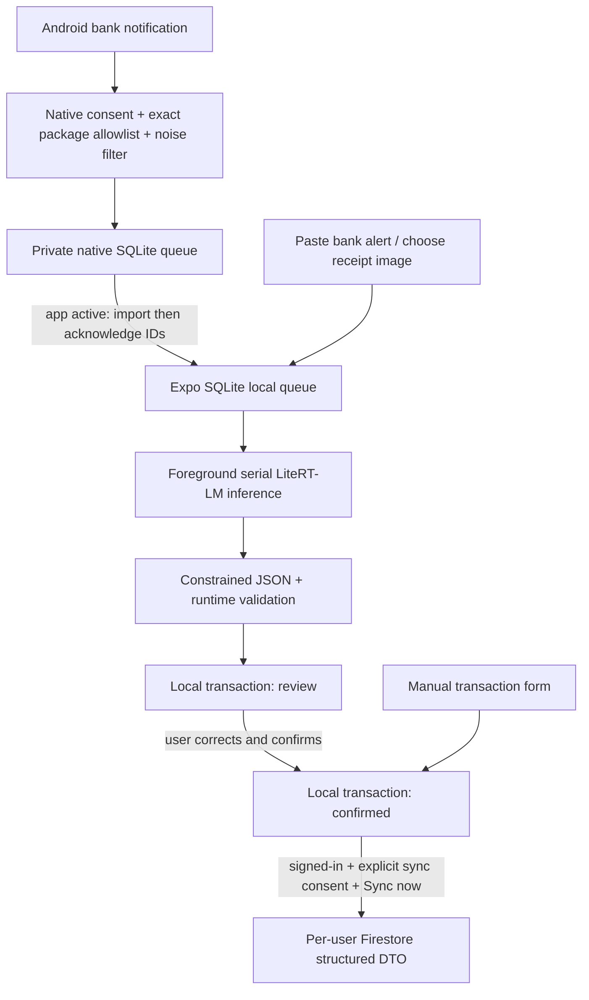

# Kiến trúc và ranh giới riêng tư

## Luồng thật

Không tạo Headless JS runtime để load model khi notification tới. Native listener tồn tại độc lập với React tree và ghi dữ liệu trước; app nhập theo page 200 mục, ack sau khi ghi bền vững. Nếu crash sau save trước ack, ID/repository replay không tạo thêm giao dịch hoặc ghi đè bản người dùng đã sửa. Inference được serialize, mỗi alert dùng conversation riêng; khi app rời foreground thì output đang chạy bị vô hiệu và model được giải phóng theo hàng đợi.

## Trạng thái dữ liệu

- `alert_queue`: raw text hoặc đường dẫn ảnh local, receivedAt, nguồn; raw lỗi inference không được lưu. Thất bại giữ hàng đợi để retry/discard.
- `transactions`: số tiền nguyên VND dương, hướng thu/chi, merchant, category enum, thời điểm ISO, confidence; AI luôn `review`, manual/được duyệt là `confirmed`.
- Dashboard/budget chỉ tính `confirmed`. Confidence tự model ước lượng, không phải xác suất đã hiệu chuẩn.
- `processed_alerts`: ID đã xử lý để chống replay. Không chứa nội dung notification.
- `settings`: ngân sách, consent đồng bộ, chủ tài khoản cloud đã gắn dữ liệu.
- Xóa giao dịch là tombstone (`deletedAt`), không xóa vật lý cloud để tránh máy offline khôi phục giao dịch cũ.

## Deduplication

Exact native alert ID được xử lý idempotent. Hai alerts khác nhau có amount/currency/direction trong 5 phút là **ứng viên nghi trùng**, không được tự gộp. UI cảnh báo khi review; người dùng xác nhận hoặc xóa. Cách này tránh bucket 5 phút làm lọt cặp sát ranh giới, đồng thời không mất hai giao dịch cùng số tiền hợp lệ. Cùng giao dịch từ hai thiết bị có ID khác nhau vẫn có thể cần review thủ công.

## Firebase

Đường dẫn duy nhất: `users/{uid}/transactions/{id}`. DTO dùng danh sách field rõ ràng, không spread row local vào write. Không sync `sourcePackage`, raw queue, ảnh, prompt, model output hoặc error. Tuy nhiên **giao dịch đã parse vẫn là dữ liệu tài chính nhạy cảm**, không phải dữ liệu vô danh.

Email/password auth persistent, không tự tạo anonymous account. Người dùng bật consent và bấm Sync; không background cloud upload. Sync LWW theo `updatedAt`, page đọc tối đa 100 và giao dịch ghi theo nhóm tuần tự, giữ newer local edits, revision-conditional markSynced. Equal revision server thắng trừ tombstone thắng live. Transaction Firestore và rules từ chối ghi stale. Clock skew giữa thiết bị có thể gây xung đột LWW; đội cần kiểm tra thời gian thiết bị trước demo. Không phải CRDT/strong consistency giữa nhiều máy offline.

Một database local gắn với UID cloud đầu tiên. Đăng xuất tắt sync nhưng không xóa dữ liệu local; đăng nhập UID khác không được upload/merge dữ liệu của UID cũ. Khi chuyển tài khoản trên máy dùng chung, cần xóa app data/reinstall để bắt đầu database riêng. Không dùng thiết kế này cho shared-device production trước khi có per-account encrypted databases và UX migration.

Firestore rules default deny, owner-only, kiểm tra field/type/range, không physical delete. `storage.rules` deny mọi truy cập: model mặc định tải từ artifact public đã pin checksum, không upload receipt. Rules deployment cần Firebase owner của đội.

## Lưu trữ và backup

- Native Android queue đặt trong `noBackupFilesDir`; config plugin tắt backup/device transfer của app, listener được bảo vệ bằng system binding permission.
- iOS helper đặt và kiểm tra cờ excluded-from-backup trên Documents/Application Support trước khi database, ảnh và model được tạo. Helper cần development build; không âm thầm bỏ qua nếu native module thiếu.
- Ảnh được copy sang private Documents để không mất khi cache picker bị dọn, xóa sau parse/discard. Model cache dùng native ModelRegistry, checksum SHA-256 trước load; OS có thể evict cache.
- Raw queue logic hết hạn sau 7 ngày; native có expiry alarm và boot reschedule; JS prune khi app chạy/refresh. OS có thể trì hoãn xóa vật lý khi app force-stop/idle. Không cam kết secure erase của SSD, SQLite WAL hoặc screenshot gốc trong thư viện ảnh.
- SQLite hiện **không mã hóa SQLCipher**. Dựa trên OS sandbox, device encryption và backup exclusion; máy root/jailbreak hoặc unlocked shared device không được bảo vệ đầy đủ. Không log dữ liệu thật. Bản production cần threat model, app lock/encryption và kiểm thử bảo mật riêng.

## Giới hạn nền tảng

Android permission listener do người dùng cấp trong Settings sau disclosure. Không xin READ_SMS, không bắt toàn bộ notification để gửi cloud. Không đảm bảo listener qua force-stop/revoke/OEM background kill. Battery Settings chỉ hướng dẫn người dùng, không tự ép exemption.

iOS không đọc notification app khác. Đường hiện có là nhập văn bản thủ công/chọn ảnh local. Không cài email forwarding/IMAP/webhook hoặc Shortcuts App Intent/share extension: các đường đó là lựa chọn kiến trúc khác, không được quảng cáo như đã có trong app. Raw qua HTTP webhook không còn local-only.

Web chạy SQLite thực, nhập/sửa/xóa, review/budget/auth/sync; không LiteRT hoặc Android capture. SQLite WASM cần COOP/COEP headers, cấu hình Metro và hosting đã có.

## Model

`Gemma 4 E2B IT`, artifact 2,588,147,712 bytes (~2.59 GB decimal), pinned revision và SHA-256 trong `src/core/ai/engine.ts`. Tải có user action/progress/resume; không weights trong Git/APK. URL/hash override phải cùng có giá trị, HTTPS/hash hợp lệ; đội tự xác minh license và modality của artifact thay thế. Không truyền HF token qua biến EXPO_PUBLIC.

LiteRT-LM binding `react-native-litert-lm@0.8.2` dùng Nitro, built-in available-memory preflight, không force-load. Context 4096, vision budget560; máy ít RAM vẫn có thể từ chối load dù tổng RAM >=4 GB. GPU/NPU không được đảm bảo trên mọi chipset; runtime chọn backend hỗ trợ bundle. App không tự gửi input lên cloud nếu load thất bại; nhập thủ công là đường dùng được.

Schema-constrained JSON không bảo đảm nội dung đúng, không loại hết prompt injection. Prompt coi input là untrusted, validator chặn unknown keys/amount/currency/date/category sai; con người review trước khi tính tổng/sync.

Nguồn: [Expo SDK58](https://docs.expo.dev/versions/v58.0.0/), [local modules](https://docs.expo.dev/modules/get-started/), [LiteRT binding0.8.2](https://github.com/hung-yueh/react-native-litert-lm/tree/v0.8.2), [artifact/hash](https://huggingface.co/api/models/litert-community/gemma-4-E2B-it-litert-lm?blobs=true), [Android listener](https://developer.android.com/reference/android/service/notification/NotificationListenerService).

## Play policy không đồng nghĩa với SMS/Accessibility declaration

Notification listener ở đây dùng binding permission của hệ thống, không READ_SMS và không AccessibilityService. Không suy ra rằng mọi listener đều có cùng yêu cầu video/declaration như Accessibility API. [Policy Sensitive Permissions hiện hành](https://support.google.com/googleplay/android-developer/answer/16558241) yêu cầu mục đích cốt lõi, tối thiểu hóa dữ liệu, disclosure/consent và tuân thủ User Data; việc Play Console yêu cầu bổ sung phụ thuộc API và phiên bản policy. Đội phải kiểm tra Console thực tế trước khi publish. Disclosure trong app không thay thế privacy policy công khai.
